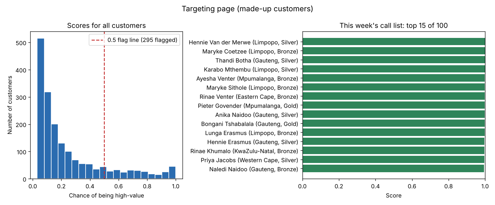

# High-Value Customer Targeting (Python + SQL + Power BI)

*SQL = Structured Query Language, the language for databases. Power BI = Microsoft's business intelligence and reporting tool.*

**Which customers should the loyalty team call this week?**

A shop's loyalty team can only phone about 100 customers a week. Right now they pick names by feel.
I built a model that gives every customer a score: the chance that they are one of the shop's best customers.
The team then calls the 100 customers with the highest scores.

The shop is made up. It is called **Mzansi Retail** and has 12 stores in South Africa, 2,000 loyalty members and 25,000 orders from 2023 to 2025.



---

## The result in one sentence

On customers the model had never seen, **88% of the top-scored customers were high-value, compared to 25% if you pick at random. That is about 3.5 times better.**

---

## What "high-value" means

A customer is **high-value** if their total spend is in the **top 25%** of all customers.
In this data that means spending **R19,271.59 or more** (completed orders only).

## What the model looks at

For each customer, I only use their **first 180 days** of shopping:

| Feature | What it means |
|---|---|
| `early_orders` | How many items they bought |
| `early_spend` | How much money they spent |
| `early_categories` | How many different products they bought |

The idea: if we can spot good customers early, the team can look after them sooner.

## The model

I used **logistic regression**. It gives each customer a number between 0 and 1: the chance that they are high-value.
Banks use the same kind of model for credit scoring.

---

## How I tested it (honestly)

I kept **25% of the customers aside** (450 customers). The model never saw them while it was learning.
Then I scored them and checked the answers.

| Check | Result |
|---|---|
| AUC (Area Under the Curve) | **0.83** |
| Top 25 of the 450 test customers | **88%** are high-value |
| Random pick | 25% are high-value |
| Lift | **3.5 times** better than random |

**What AUC 0.83 means:** take one high-value customer and one normal customer at random. The model gives the high-value one the higher score 83% of the time. (0.5 would be a coin flip, 1.0 would be perfect.)

**Why the top 25?** The team calls 100 out of 1,800 customers, which is about 5.5%. 25 out of 450 test customers is the same share.

**What matters most in the model** (scaled coefficients):
- `early_spend` **+1.10**: early spending is the strongest sign.
- `early_categories` **+0.54**: customers who buy many different products also tend to become high-value.
- `early_orders` **+0.12**: the number of items adds only a little once spend is known.

Full output: [`results/evaluation.txt`](results/evaluation.txt).

---

## A weakness I want to be clear about

**The model partly answers its own question.** Early spending is part of total spending.
So a customer who spends a lot in the first 180 days already has a head start towards the top 25%.
This makes the model look better than it would be in real life.

A better version 2 would use **this year's** shopping to predict **next year's** spending.
For now, I treat the model as a **screening tool**: it shows who deserves attention now. It is not a promise of future spending.

I would rather show this weakness than hide it.

---

## How the scores reach the business

1. `score_customers.py` trains the model on all customers and scores everyone.
2. It writes the scores into a database table called **`customer_scores`**.
3. Power BI reads that table like any other table and shows the **Targeting page**: the top 100 names, sorted by score.
4. The script can run every month (for example with Windows Task Scheduler), so the list stays fresh.

**Why write to the database and not send a CSV (comma-separated values) file?** A table in the database has the same security, refresh and history as all the other company data. A CSV on someone's laptop has none of that.

In the full run, 295 of the 1,800 customers score above 0.5. The call list is in [`results/top100_call_list.csv`](results/top100_call_list.csv).

The picture above is a preview of the Targeting page, drawn with Python. In Power BI the page has the same two parts: a table of the top 100 customers and a bar chart of all scores.

---

## How to run it

```bash
pip install -r requirements.txt
python src/generate_data.py     # makes the data and data/mzansi_retail.db
python src/train_evaluate.py    # honest test on 25% of customers
python src/score_customers.py   # scores everyone and writes customer_scores
```

It uses **SQLite** by default, so it runs on any computer. To use **SQL Server** instead, set `DATABASE_URL` (URL = the web-style address of the database) before you run it:

```bash
rem ODBC = Open Database Connectivity, the driver Windows uses to talk to SQL Server
set DATABASE_URL=mssql+pyodbc://localhost\SQLEXPRESS/MzansiRetail?driver=ODBC+Driver+18+for+SQL+Server&trusted_connection=yes&TrustServerCertificate=yes
```

## Files

```
├── src/
│   ├── generate_data.py    # makes the made-up Mzansi Retail data
│   ├── features.py         # builds the label and the 3 features (shared by both scripts)
│   ├── train_evaluate.py   # trains on 75%, tests on 25%
│   └── score_customers.py  # scores everyone, writes customer_scores, draws the picture
├── sql/
│   ├── 01_schema.sql       # the 5 tables
│   └── 02_check_scores.sql # checks the scores table and lists the top 100
├── results/                # test results and the top 100 call list
├── images/                 # the Targeting page preview
└── data/README.md          # how the data is made
```

## Note

This project comes from the study guide I wrote for myself, based on real senior data analyst job ads. I first built it in 2026 on a laptop that later broke, so I rebuilt it and put it here. The data is made up, so the numbers are a little different from my first version.

**Tools:** Python · pandas · scikit-learn · SQLAlchemy · SQLite / SQL Server · Power BI · matplotlib

---

*Rolivhuwa Thomoli*
